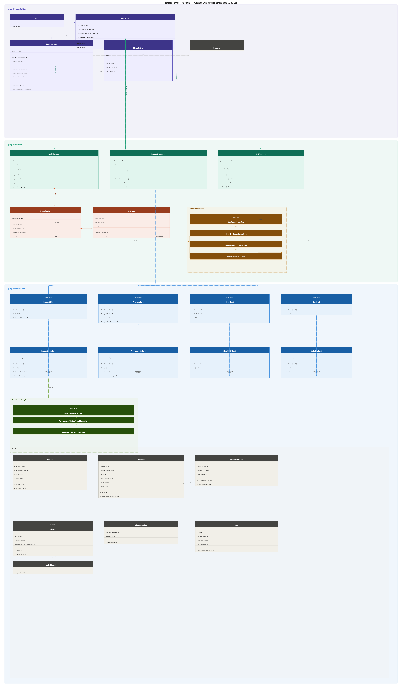

# Nude Eye

> A Java console application to run an optical shop — clients, catalogue, shopping cart, checkout and purchase history — built around clean object-oriented design.

Object-Oriented Design & Programming course project · La Salle — Universitat Ramon Llull · 2025/26



## What it does

- Register and log in clients of three types: **in-person**, **online** and **corporate**.
- Browse a catalogue of **glasses, contact lenses, consumables and services**.
- Build a shopping cart, check out, and review the full purchase history of each client.
- Compute prices, VAT and **distance-based shipping fees** for online orders.

## Design highlights

- **Three-layer architecture** — `presentation` (UI + controller), `business` (domain model and managers) and `persistence` (data access).
- **Dual persistence with the DAO pattern** — one DAO interface per entity (`Client`, `Product`, `Provider`, `Sale`) with two implementations: local **JSON/CSV files** or a **remote REST API**. At start-up the controller probes the API and injects the right set of DAOs into the managers.
- **Inheritance-based domain model** — `Client` → `InPersonClient` / `OnlineClient` / `CorporateClient`; `Product` → `PhysicalProduct` (`Glasses`, `ContactLens`) / `Consumable` / `Service`, each with its own pricing logic.
- **Open–closed VAT logic** — a hook method (`appliesVAT()`) lets each product type decide its tax without touching the pricing code.
- **Polymorphic JSON deserialization** using a discriminator field (`client_type`, product type).
- **Two exception hierarchies** — business errors (`OutOfStockException`, `ClientNotFoundException`…) kept separate from persistence errors (`PersistenceException`…).
- **Geolocation** — a `GeolocationApiManager` computes the distance used for shipping fees.

## Project structure

```
Main.java
src/
├── presentation/   Controller, UserInterface
├── business/       domain model, managers, business exceptions
└── persistence/
    ├── dao/        DAO interfaces
    ├── impl/       JSON / CSV / API implementations
    └── exception/  persistence exceptions
lib/                course-provided libraries (ApiHelper, CoordinatesAPI, json-simple)
clients.json · products.json · providers.json · sales.csv   sample data
```

## Run

Requires **JDK 25** (the course-provided `CoordinatesAPI.jar` is compiled for Java 25).

```bash
javac -cp "lib/*" -d out $(find src -name "*.java") Main.java
java  -cp "out:lib/*" Main
```

Or open the folder in IntelliJ IDEA and run `Main`.

The full design report is in [`docs/report.pdf`](docs/report.pdf).

## Authors

- **Jan Porcar**
- **Francesc Mateu Vallespín**

Academic project for the Object-Oriented Design & Programming course at La Salle — Universitat Ramon Llull.
